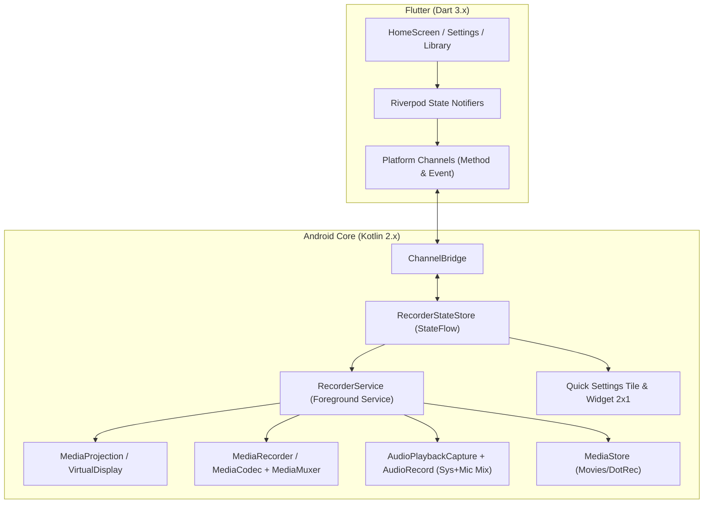

# DotRec — Бесплатная и удобная запись экрана для Android
### Free, Fast & Privacy-First Screen Recorder (Nothing OS Aesthetic)

[](https://github.com/ignatgft/dotrec/releases)
[-black.svg)](https://android.com)
[-orange.svg)](LICENSE)
[-brightgreen.svg)](#приватность-и-безопасность--privacy)
[](#эстетика-и-дизайн--design)

---

## 💡 Главная идея / Core Idea

**DotRec** — это по-настоящему **бесплатное, удобное и быстрое** приложение для записи экрана на Android. 

Большинство существующих рекордеров в магазинах перегружены навязчивой рекламой, водяными знаками, скрытыми платными подписками и запрашивают лишние разрешения. DotRec создан с совершенно иной философией:
- **100% Бесплатно**: без подписок, без заблокированных фичей и без покупок внутри приложения.
- **Никакой рекламы и водяных знаков**: чистая запись вашего экрана в максимальном качестве.
- **Полная приватность (Офлайн)**: приложение вообще не имеет разрешения `android.permission.INTERNET`. Ни один байт данных или видео не может покинуть ваше устройство.
- **Запуск в один клик**: начинайте запись мгновенно из приложения, шторки быстрых настроек, виджета на рабочем столе или плавающей плашки.

---

## 🎨 Эстетика и дизайн / Design (Nothing OS Style)

DotRec разработан с акцентом на лаконичность и визуальную гармонию:
- **Монохромная палитра**: глубокий чёрный, чистый белый и мягкие градации серого.
- **Единственный акцентный цвет**: фирменный красный (`#D71921`), используемый исключительно для индикации активной записи.
- **Точечный шрифт Doto**: стильный точечно-матричный шрифт (OFL) в духе Nothing OS.
- **Две темы с первого дня**: полноценная светлая и тёмная темы, автоматическое переключение по системе.
- **Тематическая иконка (Themed Icon)**: адаптивная монохромная иконка для рабочего стола Android 13+.

---

## ⚡ Ключевые возможности / Key Features

### 1. Точки входа (4 способа запуска)
- **Главный экран**: удобная центральная кнопка с 6 визуальными состояниями (готов, отсчёт 3-2-1, запись, пауза, сохранение, ошибка).
- **Плитка быстрых настроек (Quick Settings Tile)**: запуск/остановка из шторки уведомлений с таймером прямо в подписи плитки (кнопка быстрого добавления на Android 13+).
- **Виджет рабочего стола 2×1**: стильный виджет в светлой и тёмной темах для старта и остановки без открытия приложения.
- **Плавающая кнопка (Floating Pill)**: компактная плашка поверх всех окон с защитой `FLAG_SECURE` (не попадает на итоговое видео).

### 2. Гибкие настройки качества
- **Умные пресеты**:
  - `Быстро` (720p, 30 FPS, оптимальный битрейт) — для отправки в мессенджеры;
  - `Баланс` (1080p, 60 FPS) — золотая середина для большинства задач;
  - `Качество` (максимальное разрешение, 60/90/120 FPS, высокий битрейт) — для игр и презентаций;
  - `Свой выбор` — ручная настройка всех параметров.
- **Разрешение**: от 480p до 1080p+ (с автоподгонкой под пропорции экрана устройства).
- **FPS**: 30, 60, 90, 120 (с защитой: нельзя выбрать частоту выше возможностей дисплея устройства).
- **Битрейт**: точная регулировка от 4 до 24 Мбит/с.
- **Кодеки**: аппаратный **H.264 (AVC)** и высокоэффективный **H.265 (HEVC)** с автоматическим безопасным откатом на H.264 при отсутствии поддержки энкодера.

### 3. Чистый звук
- Запись голоса с **микрофона** (запрос разрешения только в момент включения тумблера).
- Запись **внутреннего звука системы** и приложений (через `AudioPlaybackCapture` на Android 10+).
- Качественный синхронизированный **микс микрофона и системного звука**.

### 4. Контроль и библиотека
- **Отсчёт перед стартом**: 0с (мгновенно), 3с, 5с.
- **Пауза и продолжение**: в любой момент из приложения или шторки.
- **Уведомление в шторке**: живой хронометр, кнопки «Пауза» и «Стоп».
- **Уведомление о сохранении**: кнопки «Открыть», «Поделиться» и «Удалить».
- **Библиотека записей**: встроенный список роликов из `Movies/DotRec` с миниатюрами, длительностью, размером файлов и pull-to-refresh.

### 5. Доступность и интернационализация
- **7 языков**: Русский, English, Español, Deutsch, Français, Português, Українська (авто-определение или ручной выбор).
- **TalkBack & A11y**: озвучивание таймера раз в 10 секунд (вместо спама каждую секунду), поддержка системного масштабирования текста.

---

## 🔒 Приватность и безопасность / Privacy

- **0% Сети**: отсутствие разрешения `INTERNET` в `AndroidManifest.xml`.
- **0% Аналитики и трекеров**: приложение не собирает никаких логов и статистики.
- **Защита памяти**: проверка свободного места на накопителе (блокировка старта при `< 200 МБ`, безопасное автосохранение при `< 100 МБ`).
- **Честные разрешения**: микрофон запрашивается только при включении записи микрофона, оверлей — только при включении плавающей кнопки.

---

## 📜 Лицензия и политика публикации в сторах / License & Store Policy

Проект распространяется под лицензией **DotRec Source-Available Community License (Store-Restricted)**. Полный текст лицензии находится в файле [LICENSE](file:///D:/dev/recorder/LICENSE).

### 🇷🇺 Политика в отношении публикации (Для пользователей и разработчиков):
> **Исходный код проекта открыт для аудита безопасности, обучения, личной сборки и улучшений через Pull Request.**
>
> ⚠️ **ПУБЛИКАЦИЯ В ЛЮБЫХ МАГАЗИНАХ ПРИЛОЖЕНИЙ ТРЕТЬИМИ ЛИЦАМИ СТРОГО ЗАПРЕЩЕНА:**
> Никто, кроме автора и правообладателя (`ignatgft`), не имеет права публиковать, выкладывать или распространять готовые сборки (APK, AAB и др.) или производные версии приложения в Google Play Store, RuStore, Apple App Store, Huawei AppGallery, Samsung Galaxy Store, Xiaomi GetApps, Amazon Appstore, F-Droid или любых других каталогах приложений и маркетах.
>
> **Почему действует такое правило?**
> DotRec создан как принципиально бесплатный и честный инструмент. Запрет на публикацию в сторы защищает пользователей от недобросовестных клонов, которые воруют открытый код, вшивают в него рекламу, спам, платные подписки или вредоносные модули и выкладывают в Google Play и другие сторы под видом оригинального приложения.

### 🇬🇧 Store Distribution Policy (Summary in English):
> **The source code is publicly accessible for security inspection, education, local personal building, and contributing back to the project.**
>
> ⚠️ **APP STORE & MARKETPLACE DISTRIBUTION IS STRICTLY RESTRICTED:**
> No person or entity other than the copyright holder (`ignatgft`) is authorized to upload, publish, or distribute pre-compiled binaries (APK, AAB) or modified forks of DotRec to ANY digital application store or marketplace (including Google Play, RuStore, Apple App Store, Amazon Appstore, Galaxy Store, AppGallery, F-Droid, or any other app catalog).
>
> **Why?**
> This restriction prevents ad-farms and clone scammers from repackaging DotRec with bundled ads, trackers, paywalls, or malware and submitting them to public app stores.

---

## 🛠 Архитектура / Tech Stack



- **UI**: Flutter Stable, Riverpod 2.6+, ARB-локализация, кастомные виджеты Nothing OS.
- **Нативное ядро**: Kotlin 2.x, корутины, `ForegroundService` (тип `mediaProjection`), StateFlow.
- **Видеопайплайн**:
  - `MediaRecorder` для быстрой стандартной записи;
  - `MediaCodec` + `MediaMuxer` для тонкого захвата звука и HEVC;
  - `AudioPlaybackCapture` для внутреннего звука без потери качества.

---

## 🚀 Сборка из исходников / Build & Test

### Требования
- Flutter SDK 3.47+ (Dart 3.13+)
- Android SDK 35+ (Java 17 / JDK 17)

### Запуск тестов и анализатора
```bash
# Проверка зависимостей
flutter pub get

# Статический анализ Dart кода
flutter analyze

# Юнит-тесты Flutter
flutter test

# Юнит-тесты нативного Android-модуля (Kotlin)
cd android
./gradlew testDebugUnitTest
cd ..
```

### Сборка релизного APK
```bash
# Сборка универсального релизного APK
flutter build apk --release

# Сборка оптимизированных сплитов по архитектурам (arm64-v8a, armeabi-v7a, x86_64)
flutter build apk --release --split-per-abi

# Сборка Android App Bundle (AAB) для публикации
flutter build appbundle --release
```

### Настройка подписи релиза
Для подписания релизной сборки скопируйте `android/key.properties.example` в `android/key.properties`:
```properties
storePassword=your_keystore_password
keyPassword=your_key_password
keyAlias=dotrec
storeFile=dotrec-release.jks
```

---

## 📦 Данные для сторов / Store Metadata
Готовые тексты для карточки приложения (Google Play / RuStore) находятся в директории `store/`:
- [store/google-play-ru.txt](file:///D:/dev/recorder/store/google-play-ru.txt) — название, короткое (80 симв.) и полное описание на русском.
- [store/google-play-en.txt](file:///D:/dev/recorder/store/google-play-en.txt) — app title, short description, and full description in English.
- [store/release-notes-v1.0.0.md](file:///D:/dev/recorder/store/release-notes-v1.0.0.md) — чейнджлог для релиза v1.0.0.

---

## 👤 Автор / Author

**Ignat Gorborukov (ignatgft)**  
GitHub: [@ignatgft](https://github.com/ignatgft)  
Email: [gorborukovignst@gmail.com](mailto:gorborukovignst@gmail.com)
